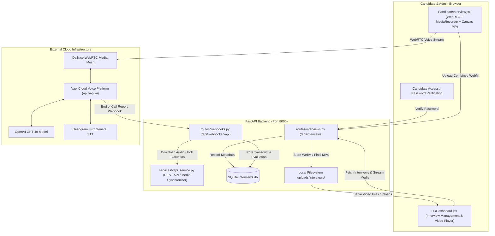
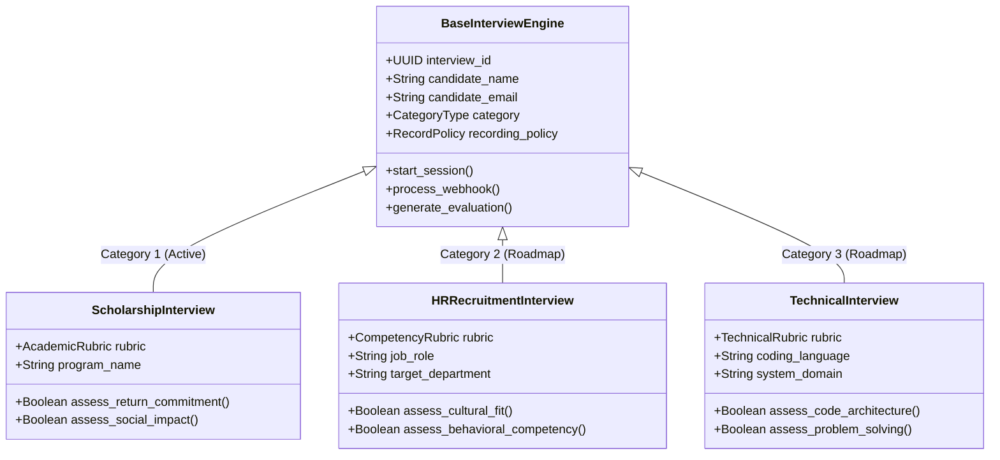
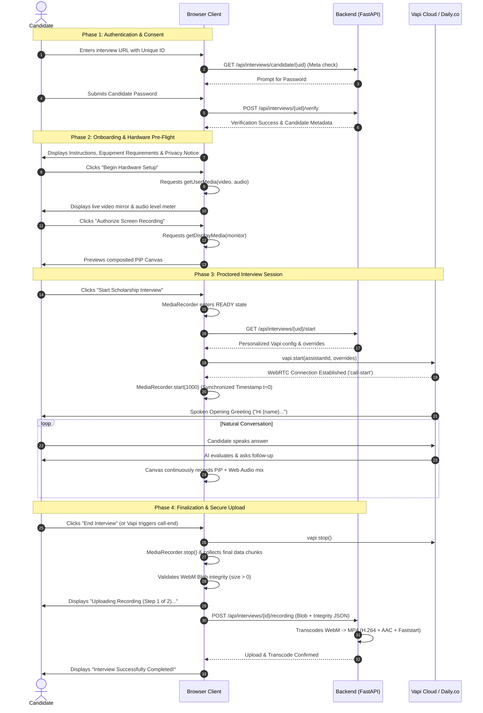
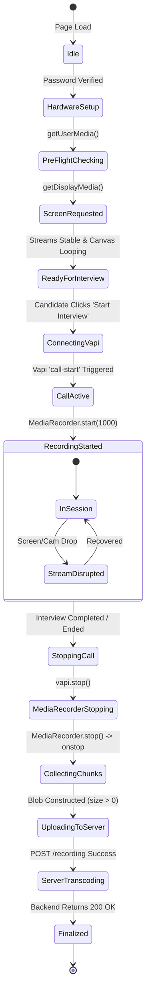
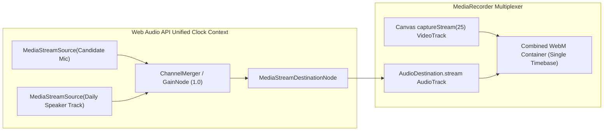
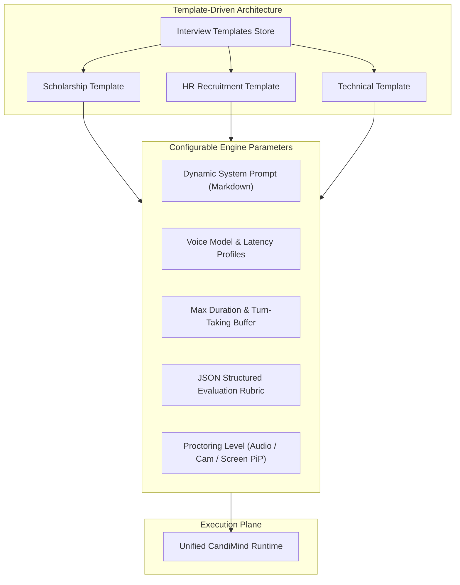
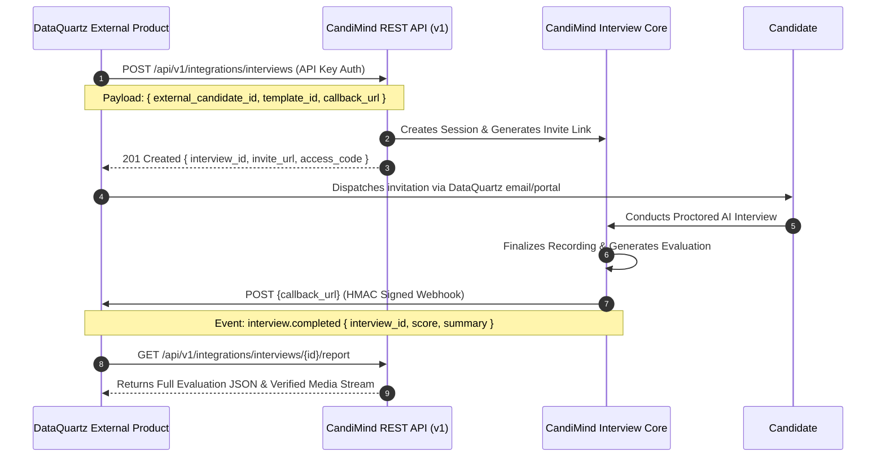
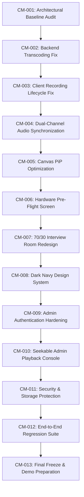

# CANDIMIND 4.0 — MASTER ARCHITECTURAL SPECIFICATION & IMPLEMENTATION ROADMAP
**Document Version:** 4.0.0-PROPOSAL  
**Author:** Principal Software Architecture & Engineering Review  
**Target Milestone:** 25 October 2026 (Scholarship Interview MVP)  
**Classification:** Internal Engineering & Executive Review  
**Status:** PROPOSED & PENDING SUPERVISOR APPROVAL  

---

## 1. Executive Summary

**CandiMind** is an AI-powered conversational assessment and proctoring platform developed to automate candidate interviews, evaluate qualitative responses, and preserve audio-visual evidence for administrative review. Originally conceived as a technical recruitment tool and recently focused on academic fellowship evaluations (specifically the Fulbright / USEFP Scholarship Program), **CandiMind 4.0** represents the architectural evolution of the system into an enterprise-grade, customizable AI interviewing platform.

This master document establishes the exhaustive architectural blueprint, codebase audit, root-cause defect analysis, security review, and daily execution plan leading to the **25 October 2026** demonstration milestone. 

### Core Strategic Focus
The immediate release focus is strictly **P0: The Scholarship Interview Module**. While the architectural foundation accommodates future HR and technical interview categories, all execution energy leading up to October 25 is dedicated to:
1. **Preserving 100% of currently operational capabilities** (Vapi voice streaming, candidate evaluation, interview workflows).
2. **Eliminating critical recording defects** (specifically WebM unfinalized EBML durations, missing video/audio segments, and silent transcoding exceptions).
3. **Establishing reliable picture-in-picture (PiP) screen + webcam recording** with synchronized candidate and AI dialogue audio.
4. **Delivering a premium, enterprise-grade dark navy SaaS user experience** (`#0D1424` theme) across candidate and administrative surfaces.
5. **Remediating high-risk security vulnerabilities** (such as hardcoded administrative credentials and unauthenticated API endpoints).

---

## 2. CandiMind Product Vision

The long-term mission of CandiMind is to deliver an **autonomous, unbiased, highly empathetic, and proctor-verified interviewing engine** capable of conducting human-grade spoken interviews across distinct institutional domains.

```
+-----------------------------------------------------------------------------------+
|                                CANDIMIND 4.0 CORE ENGINE                           |
|  +--------------------+   +-----------------------+   +------------------------+  |
|  |  Conversational AI |   |   Proctoring & Video  |   | Quantitative Analytics |  |
|  |  (Vapi / LLM Voice)|   |   (PiP / MediaStreams)|   | (Rubrics / Structured) |  |
|  +--------------------+   +-----------------------+   +------------------------+  |
+-----------------------------------------------------------------------------------+
           |                                    |                                    |
           v                                    v                                    v
+-----------------------+            +---------------------+             +---------------------+
|   USE CASE 1 (MVP)    |            |     USE CASE 2      |             |     USE CASE 3      |
| Scholarship & Academic|            |    HR Screening     |             | Technical & Coding  |
|      Interviews       |            |    Recruitment      |             |     Assessment      |
+-----------------------+            +---------------------+             +---------------------+
           |                                    |                                    |
           +------------------------------------+------------------------------------+
                                                |
                                                v
                             +-------------------------------------+
                             |   ORGANIZATIONAL ECOSYSTEM (FUTURE) |
                             |     DataQuartz Product Integration  |
                             +-------------------------------------+
```

CandiMind is designed around three pillars:
- **Verifiable Integrity:** High-fidelity multi-stream recording (candidate screen + camera inset + mixed dialogue audio) guarantees that candidates complete evaluations without unauthorized aids or proxy participants.
- **Empathetic Assessment:** Low-latency conversational voice interactions powered by high-patience system prompts allow applicants to express their authentic motivations and academic potential.
- **Administrative Transparency:** Real-time audio transcription, structured rubric grading, and evidence-backed reviewer scorecards allow review committees to make informed, defensible decisions.

---

## 3. Existing Application Overview

A deep architectural inspection of the repository located at `c:\Users\HP\Documents\candimind-v3` was conducted on 12 October 2026. The active software stack and infrastructure were verified directly from source code and dependency manifests.

### 3.1 Verified Technology Stack

| Layer | Declared / Inspected Technology | Version / Configuration | Verification Status |
| :--- | :--- | :--- | :--- |
| **Frontend Framework** | React + Vite | React `18.3.1`, Vite `7.3.1` | **VERIFIED** (`package.json`) |
| **Frontend Routing** | React Router DOM | `6.23.1` | **VERIFIED** (`App.jsx`) |
| **Voice / WebRTC Client** | `@vapi-ai/web` | `2.5.0` (Daily.co WebRTC wrapper) | **VERIFIED** (`package.json`) |
| **Icons & Styling** | `lucide-react`, Vanilla CSS | Lucide `0.263.1`, `index.css` (custom CSS custom properties) | **VERIFIED** (`index.css`) |
| **3D Rendering** | Three.js | `0.186.1` (`Avatar3D.jsx`) | **VERIFIED** (`package.json`) |
| **Backend Framework** | FastAPI (ASGI) + Uvicorn | FastAPI `0.110+`, Python `3.10+` | **VERIFIED** (`requirements.txt`) |
| **ORM / Data Layer** | SQLAlchemy | Version `2.0+` with Declarative Base | **VERIFIED** (`models.py`) |
| **Database** | SQLite (Default Dev) / PostgreSQL ready | `interviews.db` (Local SQLite binary) | **VERIFIED** (`config.py`) |
| **Transcoding & Media** | FFmpeg via `imageio-ffmpeg` | Bundled static FFmpeg `7.1-essentials` | **VERIFIED** (`vapi_service.py`) |
| **Voice AI Backend** | Vapi AI REST API | `https://api.vapi.ai` | **VERIFIED** (`vapi_service.py`) |
| **Tunneling** | ngrok | `https://adventurous-uncalked-louis.ngrok-free.dev` | **VERIFIED** (`.env`) |

### 3.2 Current High-Level System Architecture



---

## 4. Verified Features and Current Limitations

To maintain absolute architectural integrity, all platform functionality has been audited and categorized as **VERIFIED** (confirmed through active code analysis or execution) or **REPORTED** (stated in project documentation but requiring verification).

### 4.1 Feature Audit Matrix

| Feature / Subsystem | Status | Code Reference | Technical Finding / Limitation |
| :--- | :--- | :--- | :--- |
| **Candidate Interview Creation** | **VERIFIED** | `interviews.py:L54-108` | Generates unique 8-character ID, bcrypt password hash, and stores record in SQLite. |
| **Invitation Link Generation** | **VERIFIED** | `interviews.py:L77-81` | Constructs `${frontend_url}/interview/${unique_id}`. |
| **Password Access Protection** | **VERIFIED** | `interviews.py:L218-233` | Verifies candidate password against bcrypt hash before granting interview config. |
| **Vapi Web Call Initialization** | **VERIFIED** | `CandidateInterview.jsx:L427-434` | Instantiates `@vapi-ai/web` with `VITE_VAPI_PUBLIC_KEY`. |
| **Scholarship Voice Prompt** | **VERIFIED** | `scholarship-academic-prompt.md` | Contains 228 lines of Fulbright/scholarship interview instructions with 2-second silence buffer. |
| **Real-time WebRTC Voice** | **VERIFIED** | `CandidateInterview.jsx:L904` | Successfully connects audio to Vapi backend assistant `3cecb190...`. |
| **Webcam Stream Capture** | **VERIFIED** | `CandidateInterview.jsx:L597-604` | Captures 640x480 @ 24fps local video. |
| **Screen Share Acquisition** | **VERIFIED** | `CandidateInterview.jsx:L564-577` | Calls `getDisplayMedia({ video: { displaySurface: 'monitor' } })`. |
| **Canvas PiP Compositing** | **VERIFIED** | `CandidateInterview.jsx:L679-797` | Draws screen share (1280x720) with webcam inset (280x180) in bottom-right corner. |
| **Web Audio Mixing** | **VERIFIED** | `CandidateInterview.jsx:L629-637` | Initializes `AudioContext` and `createMediaStreamDestination()`. |
| **WebM MediaRecorder** | **VERIFIED** | `CandidateInterview.jsx:L836-844` | Records combined canvas stream + mixed audio to memory chunks. |
| **Chunk Upload to Backend** | **VERIFIED** | `CandidateInterview.jsx:L989` | Uploads binary blob as multipart form data to `POST /api/interviews/{id}/recording`. |
| **Vapi Webhook Handling** | **VERIFIED** | `webhooks.py:L82-280` | Handles `end-of-call-report`, saves transcript, summary, and structured outputs. |
| **Structured AI Evaluation** | **VERIFIED** | `webhooks.py:L140-150` | Parses 9 dimensions (academic background, motivation, leadership, return commitment, etc.). |
| **Admin Dashboard UI** | **VERIFIED** | `HRDashboard.jsx:L1-943` | Allows creating interviews, filtering, inspecting transcripts, and playing video. |
| **Direct MP4 Transcode** | **DEFECT** | `interviews.py:L688` | **CRITICAL DEFECT IDENTIFIED:** `subprocess` is not imported in `interviews.py`, causing direct MP4 transcoding to silently fail with `NameError`! |
| **Admin Authentication** | **DEFECT** | `HRDashboard.jsx:L12` | **SECURITY DEFECT:** Admin password `#Candimind@2026` is hardcoded in client-side React code with zero backend route protection. |
| **Static File Exposure** | **DEFECT** | `main.py:L39` | All interview recordings under `/uploads` are served statically without token authorization. |

---

## 5. Supervisor Requirements & Strategic Directives

Based on supervisor briefings, the development trajectory of CandiMind has been structured around four non-negotiable mandates:

1. **Category Discipline:** CandiMind must support exactly **THREE** predefined interview categories in its lifecycle:
   - **Category 1:** Scholarship Interviews (Current priority).
   - **Category 2:** HR Recruitment and Hiring Interviews (Future phase).
   - **Category 3:** Technical Interviews (Future phase).
   - *Strict Exclusion:* No "General Educational Interview" category shall be introduced or referenced.
2. **October 25 Milestone:** The Scholarship Interview Module must be transformed into a polished, demonstration-ready enterprise product by **25 October 2026**.
3. **Flawless Recording Reliability:** Recording failures (missing intros, mismatched audio/video lengths, broken progress bars) must be thoroughly eliminated. Decorative UI features must never be prioritized over media integrity.
4. **Integration Readiness:** The backend must be structured with clean architectural boundaries to enable future integration with DataQuartz and related corporate software assets.

---

## 6. Product Scope — Three Core Interview Categories



### Detailed Category Matrix

| Category | Primary Target User | Key Focus Dimensions | Voice Persona & Model | Technical Artifacts | Delivery Horizon |
| :--- | :--- | :--- | :--- | :--- | :--- |
| **1. Scholarship Interviews** | Fellowship & Scholarship Applicants (e.g. Fulbright) | Motivation, intellectual readiness, leadership, study goals, home-country return commitment | Empathetic Academic Evaluator (High patience, 2s silence buffer) | Screen + Webcam PiP, Synchronized Stereo Audio, 9-Criterion Academic Scorecard | **25 October 2026 (Active P0)** |
| **2. HR Recruitment Interviews** | Job Candidates & Talent Acquisition Teams | Communication, behavioral competencies (STAR), situational judgment, cultural alignment | Professional Corporate Recruiter (Structured, conversational) | Video recording, behavioral transcript analysis, recruiter candidate comparison matrix | **Post-MVP (Phase 2)** |
| **3. Technical Interviews** | Software Engineers, Data Scientists, DevOps | Algorithmic logic, code explanation, architectural reasoning, debugging capabilities | Senior Staff Architect (Technical, precise follow-ups) | Screen recording (IDE inspection), technical evaluation rubric, syntax reasoning report | **Post-MVP (Phase 3)** |

---

## 7. MVP Scope for 25 October 2026

The October 25 deliverable is strictly bounded to the **Scholarship Interview Module Upgrade**.

### 7.1 Scope Inclusions (P0 & P1)

```
+-----------------------------------------------------------------------------------------+
|                                25 OCTOBER 2026 MVP DELIVERABLE                          |
+-----------------------------------------------------------------------------------------+
| [P0] Recording Fix: Fix missing import subprocess, enforce MP4 transcode + faststart    |
| [P0] Recording Lifecycle: Pre-buffer media streams before Vapi call-start               |
| [P0] Audio Pipeline: Clean dual-voice mixing (Candidate mic + Assistant Daily audio)    |
| [P0] Screen Capture: Stable getDisplayMedia() + Canvas PiP (Screen 720p + Cam 180p)     |
| [P0] Vapi Preservation: Retain scholarship-academic-prompt.md & structured scoring      |
| [P0] Admin Playback: Video player supporting seeking, true duration, and audio control  |
| [P1] Candidate UI: Dark Navy enterprise redesign (#0D1424), 70/30 interview room layout |
| [P1] Device Pre-Flight: Dedicated camera/microphone/screen permission & test modal     |
| [P1] Admin Security: Session token auth for dashboard & protected recording downloads   |
| [P1] Error Recovery: Reconnection and graceful error states during media drops          |
+-----------------------------------------------------------------------------------------+
```

### 7.2 Explicit Scope Exclusions (Deferred to Post-MVP)
- Implementation of HR interview creation or evaluation forms.
- Implementation of Technical coding environments or syntax execution runners.
- Live external DataQuartz production API integrations.
- Multi-tenant enterprise organization billing systems.
- Live candidate face-mesh biometric identity verification.

---

## 8. Scholarship Interview User Journey

The candidate experience must be friction-free, unambiguous, and reassuring.



---

## 9. Premium UI/UX Design Specification

The current user interface utilizes high-saturation purples and cyans (`hsl(262, 83%, 58%)`). The CandiMind 4.0 design system transitions the entire application into an **elite, executive-tier dark navy aesthetic** modeled after mission-critical enterprise software.

### 9.1 Design System Tokens

```css
:root {
  /* Surface Color Palette */
  --cm-bg-base: #0D1424;         /* Deep obsidian navy base */
  --cm-bg-surface: #172238;      /* Primary card/panel container */
  --cm-bg-elevated: #202F49;     /* Dropdowns, modals, elevated cards */
  --cm-bg-highlight: #2A3C5C;    /* Active states, hover states */
  
  /* Border & Stroke */
  --cm-border-subtle: rgba(130, 156, 255, 0.12);
  --cm-border-strong: rgba(130, 156, 255, 0.28);
  --cm-border-focus: #829CFF;

  /* Typography Colors */
  --cm-text-primary: #F5F7FD;    /* High-contrast crisp white */
  --cm-text-secondary: #9EAFCB;  /* Soft slate secondary text */
  --cm-text-tertiary: #627494;   /* Disabled / subtle metadata */

  /* Semantic & Accent Palette */
  --cm-accent-primary: #829CFF;  /* Radiant indigo/soft blue */
  --cm-accent-hover: #9CB2FF;    /* Accent hover state */
  --cm-accent-muted: rgba(130, 156, 255, 0.15);
  
  --cm-status-success: #85DBBB;  /* Mint seafoam success */
  --cm-status-warning: #FFD166;  /* Soft amber warning */
  --cm-status-danger: #F4737D;   /* Coral crimson recording/error */
  --cm-status-live: #EF4444;     /* Pulsing recording indicator */

  /* Typography */
  --cm-font-sans: 'Inter', -apple-system, BlinkMacSystemFont, 'Segoe UI', Roboto, sans-serif;
  --cm-font-mono: 'JetBrains Mono', 'Fira Code', monospace;

  /* Shadows & Depth */
  --cm-shadow-card: 0 8px 32px -4px rgba(5, 10, 20, 0.5);
  --cm-shadow-popover: 0 16px 48px -8px rgba(0, 0, 0, 0.7);
  --cm-shadow-glow: 0 0 24px -4px rgba(130, 156, 255, 0.25);
}
```

---

## 10. Candidate Interview Room Layout

The live interview interface will adopt a balanced **70 / 30 asymmetric desktop layout** engineered to eliminate visual distraction while maximizing conversational engagement.

```
+--------------------------------------------------------------------------------------------------+
| CANDIMIND 4.0  |  Fulbright Masters Scholarship Interview   | (REC) 14:28 | AI Connected: OK     |
+--------------------------------------------------------------------------------------------------+
|                                                                 |                                |
|                   LEFT AREA: AI INTERVIEWER (70%)               |   RIGHT AREA: PROCTOR (30%)    |
|                                                                 |                                |
|  +-----------------------------------------------------------+  |  +--------------------------+  |
|  |                                                           |  |  |   CANDIDATE WEBCAM       |  |
|  |                                                           |  |  |   [Live Mirrored Feed]   |  |
|  |                    [ 3D / 2D AVATAR ]                     |  |  |                          |  |
|  |                                                           |  |  +--------------------------+  |
|  |                                                           |  |  | Cam: 1080p | Mic: 48kHz  |  |
|  +-----------------------------------------------------------+  |  +--------------------------+  |
|                                                                 |                                |
|  Interviewer Status: [ Speaking... ]                            |  +--------------------------+  |
|  Audio Waveform:  | | || |||| || || |                           |  |   SCREEN CAPTURE STATUS  |  |
|                                                                 |  |   [Entire Display 1]     |  |
|  Live Question:                                                 |  |   Shared: Active [✓]     |  |
|  "Could you elaborate on how your proposed research will        |  +--------------------------+  |
|   address specific agricultural challenges in your province?"   |                                |
|                                                                 |  +--------------------------+  |
|                                                                 |  |   SESSION INTEGRITY      |  |
|                                                                 |  |   Tab Focus: Normal      |  |
|                                                                 |  |   Window State: Locked   |  |
|                                                                 |  +--------------------------+  |
+--------------------------------------------------------------------------------------------------+
| CONTROLS: [ Mute Mic (M) ]   [ Audio Settings ]   [ Refresh Screen Share ]       [ END INTERVIEW ]|
+--------------------------------------------------------------------------------------------------+
```

### Component Details
- **AI Interviewer Stage (70%):** Centered avatar with smooth ambient animation. Radial glow responds dynamically to AI speaking state (`isAssistantSpeaking`). Real-time transcript caption displays below the avatar to assist candidates with acoustic or connection clarity.
- **Candidate Proctor Panel (30%):** Shows candidate webcam feed, screen-sharing operational thumbnail, live microphone audio VU meter, and integrity status indicators (tab blur count, fullscreen locked).
- **Sticky Control Bar:** Prominent controls for microphone muting, audio output switching, and an intentional, double-confirmation "End Interview" button.

---

## 11. Admin Dashboard and Results Layout

The administrative interface (`HRDashboard.jsx`) will be refactored into a high-utility assessment console.

```
+--------------------------------------------------------------------------------------------------+
| [CandiMind]  |  Interviews  |  Scholarship Candidates  |  Analytics  |  Settings  | [Admin Logout]|
+--------------------------------------------------------------------------------------------------+
| Search Candidates... [Q]   | Filter: [ Fulbright Masters v ] | Status: [ Completed v ] | [+ New Link] |
+--------------------------------------------------------------------------------------------------+
| ID   | CANDIDATE        | PROGRAM            | STATUS     | RECORDING         | SCORE | ACTIONS  |
| #26  | Hamza Ali        | Fulbright Masters  | Completed  | [▶ Play MP4 (PiP)]| 8.2/10| [Review] |
| #25  | Haroon Sheikh    | Fulbright PhD      | Completed  | [▶ Play MP4 (PiP)]| 7.9/10| [Review] |
| #24  | Sara Khan        | Hubert Humphrey    | In Progress| [Recording...]    | ---   | [Monitor]|
+--------------------------------------------------------------------------------------------------+

================================ CANDIDATE REVIEW MODAL (#26) =======================================
+-------------------------------------------------------+------------------------------------------+
|                 RECORDING PLAYBACK                    |            EVALUATION REPORT             |
|                                                       |                                          |
|  +-------------------------------------------------+  |  Overall Recommendation: [ HIGHLY REC. ] |
|  |                                                 |  |  Weighted Score: 8.4 / 10.0              |
|  |   [ SYNCHRONIZED MP4 PLAYER (H.264/AAC) ]       |  |                                          |
|  |   - Full Screen Sharing View                    |  |  CRITERIA BREAKDOWN:                     |
|  |   - Candidate Webcam Inset (Bottom-Right)       |  |  • Academic Readiness:      [ 9 / 10 ]   |
|  |   - Synchronized Dual-Channel Audio             |  |  • Motivation & Clarity:    [ 9 / 10 ]   |
|  |                                                 |  |  • Return Commitment:       [ 8 / 10 ]   |
|  +-------------------------------------------------+  |  • Leadership Potential:    [ 8 / 10 ]   |
|  [▶] 04:12 / 18:45  [---O-------------] [Vol] [⛶]     |  • Social Impact Vision:    [ 8 / 10 ]   |
|                                                       |  • Communication:           [ 7 / 10 ]   |
|  Integrity Flags: [ 0 Tab Switches ] [ Screen Intact] |                                          |
|                                                       |  EXECUTIVE SUMMARY:                      |
|  TRANSCRIPT:                                          |  Candidate demonstrated exceptional      |
|  [00:15] AI: "Welcome Hamza! Tell us about your..."   |  academic clarity regarding soil science |
|  [00:32] Hamza: "Thank you. My focus has been on..."  |  and articulated concrete return plans.  |
+-------------------------------------------------------+------------------------------------------+
```

---

## 12. Screen Recording Feature Specification

The platform recording engine must capture the candidate's active computer display while retaining continuous visual proctoring of the candidate's facial presence and conversation dialogue.

### 12.1 Operational Constraints & Browser APIs
- **Display Media Acquisition:** Uses `navigator.mediaDevices.getDisplayMedia({ video: { displaySurface: "monitor", frameRate: { ideal: 30 } }, audio: false })`. 
- **User Agency:** Browser security sandboxes mandate explicit user selection in a system modal. The application cannot programmatically force full-screen capture without candidate approval.
- **Cancellation Handling:** If a candidate cancels the picker, the application must intercept `NotAllowedError` and transition gracefully into a guidance modal explaining proctoring requirements.
- **Mid-Interview Terminations:** If the user clicks native OS "Stop Sharing", `screenTrack.onended` immediately fires, pausing the interview, sounding an alert, and logging an integrity infraction.

### 12.2 Compositing Architecture (Canvas PiP Engine)
- **Canvas Resolution:** Fixed standard 720p canvas (`1280 x 720`).
- **Screen Layer (Background):** Scales the active screen share stream maintaining aspect ratio with letterboxing (`#0a0f1d` fill).
- **Camera Inset (Foreground PiP):**
  - Dimensions: Fixed `280px` width by `180px` height.
  - Positioning: Bottom-right corner offset by `24px` margins (`x = 976`, `y = 516`).
  - Aesthetics: `12px` rounded corner clip, `3px` solid accent border (`#829CFF`), soft drop shadow (`rgba(0, 0, 0, 0.6)`).
  - Mirroring: Horizontal flip (`ctx.scale(-1, 1)`) so candidate movements feel natural.
- **Proctor Watermark:** Top-left corner displays static proctoring badge with pulsing recording indicator, UTC session timestamp, and candidate UID.

---

## 13. Recording Pipeline Architecture

The end-to-end recording flow must ingest heterogeneous client-side streams, composite them into a standardized media container, and transcode the media into a globally compatible MP4 on the server.

```mermaid
graph TD
    subgraph ClientMediaCapture["Client Media Capture (Browser)"]
        ScreenShare["Display Stream (getDisplayMedia)"]
        WebcamStream["Camera Stream (getUserMedia)"]
        MicStream["Candidate Microphone"]
        VapiWebRTC["Daily.co WebRTC Remote Assistant Audio"]
    end

    subgraph CompositingMixing["Client Compositing & Mixing"]
        CanvasCompositor["Offscreen Canvas (1280x720 @ 25fps)"]
        AudioMixer["Web Audio API (MediaStreamDestination)"]
        CombinedStream["Combined MediaStream (1 Video Track + 1 Audio Track)"]
        ClientRecorder["MediaRecorder (video/webm; codecs=vp8,opus)"]
    end

    subgraph ClientUpload["Client Finalization"]
        BlobAssembly["Blob Assembly (1000ms timeslices)"]
        UploadHandler["FormData POST /recording"]
    end

    subgraph BackendProcessing["Server Processing (FastAPI + FFmpeg)"]
        ReceiveWebM["Save Raw WebM uploads/interviews/"]
        FFmpegTranscode["FFmpeg Server Transcoding Engine"]
        FaststartMP4["Final Web-Optimized MP4 (H.264 + AAC + moov faststart)"]
        DBCatalog[("SQLAlchemy DB: interview_results")]
    end

    ScreenShare -->|Draw Background| CanvasCompositor
    WebcamStream -->|Draw Bottom-Right Inset| CanvasCompositor
    MicStream -->|connect()| AudioMixer
    VapiWebRTC -->|connect()| AudioMixer
    
    CanvasCompositor -->|captureStream(25)| CombinedStream
    AudioMixer -->|destination.stream| CombinedStream
    
    CombinedStream --> ClientRecorder
    ClientRecorder --> BlobAssembly
    BlobAssembly --> UploadHandler
    
    UploadHandler --> ReceiveWebM
    ReceiveWebM --> FFmpegTranscode
    FFmpegTranscode --> FaststartMP4
    FaststartMP4 --> DBCatalog
```

---

## 14. Recording Lifecycle and State Machine

To prevent early cutoffs and unfinalized blobs, the client recording engine must adhere to a strict deterministic state machine.



### Deterministic State Transitions

| Transition | From State | To State | Trigger Condition | Required Side Effects | Failure State & Recovery |
| :--- | :--- | :--- | :--- | :--- | :--- |
| **T1: Auth** | `Idle` | `HardwareSetup` | Candidate enters valid password | Sets `passwordVerified = true`, loads interview metadata | `InvalidPassword`: displays shake animation |
| **T2: PreFlight** | `HardwareSetup` | `PreFlightChecking` | Candidate clicks "Begin Equipment Check" | Requests webcam and microphone permissions | `NotAllowedError`: prompts user to unlock browser lock icon |
| **T3: Screen** | `PreFlightChecking` | `ReadyForInterview` | Candidate clicks "Authorize Screen" | Resolves `getDisplayMedia()`, kicks off 25fps canvas render loop | `PermissionDenied`: keeps candidate on check screen |
| **T4: Start** | `ReadyForInterview` | `RecordingStarted` | Vapi fires `call-start` event | Sets `videoStartTime = Date.now()`, calls `mediaRecorder.start(1000)` | If Vapi fails: reset recorder to inactive |
| **T5: Disruption** | `RecordingStarted` | `StreamDisrupted` | `screenTrack.onended` fires | Sets warning banner, logs `screen_stopped` integrity event | Candidate prompted to re-select screen |
| **T6: Stop** | `RecordingStarted` | `CollectingChunks` | User clicks End or Vapi `call-end` | Calls `recorder.stop()`, waits for final `ondataavailable` | Timeout fallback (1500ms force upload) |
| **T7: Upload** | `CollectingChunks` | `ServerTranscoding` | Final Blob constructed and verified | Sends multipart POST with integrity metadata | `NetworkError`: retry up to 3 times before manual save |
| **T8: Transcode** | `ServerTranscoding` | `Finalized` | Backend returns MP4 URL | Updates UI to completion screen, frees local tracks | Logs server transcode warning; falls back to WebM |

---

## 15. Audio/Video Synchronization Strategy

Synchronization errors in browser-based recording arise from two distinct physical sources:
1. **Clock Disparity Between Canvas & AudioContext:** Canvas capture (`canvas.captureStream(25)`) operates on requestAnimationFrame timing, whereas AudioContext operates on audio hardware sampling clocks (48,000 Hz).
2. **WebRTC Web Audio Injection Delay:** Vapi / Daily.co audio streams arrive over WebRTC UDP sockets 200–500ms after local hardware streams initialize.

### Synchronization Architecture



### Critical Synchronization Safeguards
1. **Unified Client Multiplexing:** Rather than saving video in one file and downloading audio from Vapi servers in another (and attempting complex millisecond timestamp alignment post-hoc), the client engine mixes candidate and assistant audio into a single `MediaStreamDestination` that is fed directly into the `MediaRecorder`. **Video and audio are multiplexed into the same WebM container at frame 0**, guaranteeing zero external synchronization drift.
2. **Audio Track Pre-buffering:** The `MediaRecorder` is never started until both video and audio tracks are active in the combined `MediaStream`.

---

## 16. Existing Recording Bug Investigation

A comprehensive investigation into reported recording defects (specifically instances where a final output exhibited **5.72s video duration vs 2.96s audio duration**, and missing opening segments) yielded four concrete technical discoveries:

### 16.1 Finding 1: Silent Transcoding Failure (`interviews.py`) — **VERIFIED DEFECT**
In `backend/routes/interviews.py` (lines 665–695):
```python
# CODE AUDIT: lines 670-693 of interviews.py
try:
    import imageio_ffmpeg
    ffmpeg_exe = imageio_ffmpeg.get_ffmpeg_exe()
    ...
    proc = subprocess.run(cmd, capture_output=True, text=True) # <-- DEFECT: subprocess NOT imported!
    ...
except Exception as e:
    print(f"⚠️ Direct MP4 transcode fallback: {e}")
```
* **Discovery:** `import subprocess` is missing at the module level in `interviews.py`. 
* **Impact:** Every single direct MP4 transcode execution on lines 670–693 immediately throws `NameError: name 'subprocess' is not defined`.
* **Consequence:** The exception is caught by the `try...except` block, printing a silent warning. The server falls back to returning the raw `.webm` file. The final MP4 is never generated!

### 16.2 Finding 2: Unfinalized WebM EBML Headers (`Duration: N/A`) — **VERIFIED DEFECT**
An inspection of raw `.webm` files recorded today in `backend/uploads/interviews` (e.g. `interview_26_20261012_133512_7ylkTPUi.webm`, size 22.5 MB) using FFmpeg revealed:
```text
Duration: N/A, start: 0.000000, bitrate: N/A
Stream #0:0: Video: vp8, 1280x720, 1k tbr
Stream #0:1: Audio: opus, 48000 Hz, stereo
```
* **Discovery:** Browser `MediaRecorder` generates WebM containers in real-time chunk streams without writing the final duration into the EBML Segment header.
* **Impact:** Chrome, Edge, and Firefox HTML5 `<video>` tags cannot read the duration of an unfinalized WebM file. The progress bar displays `0:00 / 0:00` or infinity, and scrubbing/seeking fails completely.

### 16.3 Finding 3: Truncation from `-shortest` Flag (`vapi_service.py`) — **VERIFIED DEFECT**
In `backend/services/vapi_service.py` line 384:
```python
cmd = [
    ffmpeg_exe, "-y",
    "-fflags", "+genpts",
    "-i", video_abs,
    "-i", audio_abs,
    ...
    "-shortest",   # <-- DEFECT: truncates entire video to the shorter stream!
    merged_abs
]
```
* **Discovery:** The legacy merge pipeline in `vapi_service.py` specifies the `-shortest` flag. If the Vapi audio download completed before the candidate closed the window (or if Vapi stopped recording 3 seconds early), FFmpeg violently truncates the 18-minute video down to whatever audio length was provided.

### 16.4 Finding 4: Track Tear-Down Race in Client Lifecycle — **VERIFIED DEFECT**
In `frontend/src/pages/CandidateInterview.jsx` lines 941–947:
```python
// Stop VAPI if still active
if (vapiInstance && vapiCallStartedRef.current) {
    vapiInstance.stop(); // <-- Destroys Daily WebRTC tracks immediately!
}
...
recorder.stop(); // <-- Stopped AFTER audio tracks were destroyed!
```
* **Discovery:** `vapiInstance.stop()` was invoked *before* `mediaRecorder.stop()`. Daily.co immediately tears down WebRTC remote audio tracks, creating a dead audio buffer in the recorder before the final chunk is saved.

---

## 17. Scholarship AI Interviewer Refinement

The conversational engine utilizes Vapi AI linked to OpenAI `gpt-4o` and Deepgram `flux-general-en`.

### 17.1 System Prompt Audit (`scholarship-academic-prompt.md`)
The prompt file was audited and found to be well-constructed for Fulbright and international scholarship evaluations. Key attributes:
- **Patience Directives:** Enforces a minimum 2-second silence buffer before AI speech initiation.
- **Tone:** Professional, neutral, and encouraging without coaching.
- **Criteria Evaluated:** Intellectual readiness, study goals, leadership, community impact, career vision, and mandatory home-country return commitment.

### 17.2 UI Consistency Refinements
The code currently contains legacy strings mentioning "AI Technical Interviewer" or "HR Interviewer". All candidate-facing labels in `CandidateInterview.jsx` and `HRDashboard.jsx` must be standardized to:
* **"AI Scholarship Interviewer"** / **"Scholarship Selection Committee Voice Assistant"**.

---

## 18. Security and Privacy Review

An architectural security audit identified several high-priority vulnerabilities that must be addressed to ensure candidate data privacy and compliance.

### 18.1 Vulnerability Classification Matrix

| Vulnerability ID | Severity | Component | Finding Description | Remediation Plan (MVP / Post-MVP) |
| :--- | :--- | :--- | :--- | :--- |
| **SEC-001** | **CRITICAL** | `HRDashboard.jsx:L12` | **Plaintext Admin Password:** Admin password `#Candimind@2026` is hardcoded in client-side React code and verified in `localStorage`. | **MVP P0:** Move password verification to a backend endpoint (`/api/auth/login`) that returns an HTTP-only JWT session cookie. |
| **SEC-002** | **CRITICAL** | `routes/interviews.py` | **Unauthenticated Endpoints:** `GET /api/interviews`, `POST /api/interviews/create`, and `DELETE /api/interviews/{id}` have zero auth guards. Anyone can list or delete candidate records. | **MVP P0:** Add FastAPI `Depends(verify_admin_token)` dependency to all administrative routes. |
| **SEC-003** | **HIGH** | `main.py:L39` | **Public Static Video Directory:** Static mount `/uploads` serves candidate recordings to anyone with the filename. | **MVP P1:** Implement protected streaming endpoint (`/api/interviews/{id}/video`) requiring admin authentication. |
| **SEC-004** | **HIGH** | `routes/webhooks.py` | **Unverified Webhook Requests:** `/api/webhooks/vapi` does not validate secret headers from Vapi. | **MVP P1:** Validate `x-vapi-secret` or bearer token header against `settings.vapi_secret_key`. |
| **SEC-005** | **MEDIUM** | `backend/.env` | **Ngrok Domain Exposure:** Public development tunnels are committed or visible in environment files. | **MVP P1:** Add `.env` validation script and verify `.gitignore` ignores all local credentials. |

---

## 19. Existing Codebase Architecture

```
candimind-v3/
├── backend/
│   ├── main.py                     # FastAPI entry point, CORS, static uploads mount
│   ├── config.py                   # Pydantic BaseSettings loading from .env
│   ├── database.py                 # SQLAlchemy engine, session maker, SQLite auto-migrations
│   ├── models.py                   # Interview and InterviewResult database schemas
│   ├── requirements.txt            # Python dependencies (FastAPI, SQLAlchemy, imageio-ffmpeg)
│   ├── routes/
│   │   ├── interviews.py           # CRUD endpoints, password verification, recording upload
│   │   └── webhooks.py             # Vapi end-of-call, structured outputs, audio download
│   ├── services/
│   │   └── vapi_service.py         # Vapi REST client, prompt interpolation, FFmpeg media merger
│   └── uploads/interviews/         # Physical storage for recordings (.webm and .mp4)
├── frontend/
│   ├── package.json                # React 18, Vite, lucide-react, @vapi-ai/web
│   ├── vite.config.js              # Vite bundler configuration
│   └── src/
│       ├── App.jsx                 # Client router (/ and /interview/:uniqueId)
│       ├── index.css               # Global CSS tokens and styling classes
│       ├── components/
│       │   └── Avatar3D.jsx        # Three.js 3D avatar visualization
│       ├── pages/
│       │   ├── CandidateInterview.jsx # Core candidate proctoring, recording & interview room
│       │   └── HRDashboard.jsx     # Admin management, metrics, and video review modal
│       └── services/
│           └── api.js              # Axios REST client for backend communication
└── vapi-prompts/
    └── scholarship-academic-prompt.md # Master academic evaluation prompt
```

---

## 20. File-by-File Proposed Changes

| File Path | Nature of File | Proposed Architectural Changes | Risk Level | Acceptance Criteria |
| :--- | :--- | :--- | :--- | :--- |
| `backend/routes/interviews.py` | Core API Routes | 1. Add `import subprocess` at top.<br>2. Harden MP4 transcode with `+faststart` flag.<br>3. Add admin auth dependency to management endpoints. | **MEDIUM** | Uploaded WebM reliably converts to MP4 with verified duration; unauthenticated requests receive 401. |
| `backend/services/vapi_service.py` | Vapi Service | 1. Remove `-shortest` flag in legacy merger.<br>2. Support timeout guards on FFmpeg processes. | **LOW** | Fallback merges never truncate video duration. |
| `backend/routes/webhooks.py` | Webhook Receiver | 1. Implement secret token verification.<br>2. Add structured retry logic for evaluation artifacts. | **LOW** | Webhook securely authenticates and persists evaluation. |
| `frontend/src/pages/CandidateInterview.jsx` | Candidate UI & Recorder | 1. Split into Pre-Flight Setup & Interview Room.<br>2. Fix recorder teardown sequence (`recorder.stop()` before `vapi.stop()`).<br>3. Implement Dark Navy UI tokens (`#0D1424`). | **MEDIUM** | Complete opening footage recorded; screen sharing and camera PiP capture flawlessly. |
| `frontend/src/pages/HRDashboard.jsx` | Admin UI | 1. Remove hardcoded plaintext password.<br>2. Integrate with backend auth session.<br>3. Upgrade video player with seekable MP4 stream & PiP tags. | **LOW** | Admin logs in via backend auth; can play and seek through completed interview MP4. |
| `frontend/src/index.css` | Design System | Refactor color tokens to Dark Navy enterprise palette (`#0D1424`, `#172238`, `#829CFF`). | **LOW** | Entire UI reflects unified enterprise styling. |

---

## 21. Database and Backend Considerations

### Existing Schema Integrity
The existing database schema in [models.py](file:///c:/Users/HP/Documents/candimind-v3/backend/models.py) contains the necessary fields:
- `interviews`: `id`, `candidate_name`, `candidate_email`, `role`, `interview_link`, `unique_id`, `password_hash`, `status`.
- `interview_results`: `vapi_call_id`, `call_duration`, `transcript`, `summary`, `evaluation`, `recording_video_path`, `merged_video_path`, `integrity_summary`.

### Safe Migration Strategy
To ensure **zero data loss**:
1. All changes will be backwards-compatible additions.
2. In SQLite, new columns are handled safely via existing `init_db()` auto-alter migrations in [database.py](file:///c:/Users/HP/Documents/candimind-v3/backend/database.py#L35-L56).
3. The database file `interviews.db` must be backed up (`interviews.db.bak`) prior to any deployment.

---

## 22. Future Customizable Interview Engine (Architecture)

To fulfill the supervisor's vision of an all-in-one interviewing platform, CandiMind will introduce a **Template-Driven Assessment Engine** in subsequent phases.



---

## 23. HR Recruitment Module Roadmap (Phase 2)

*Status: FUTURE DEVELOPMENT PHASE (Post-October 25)*

### Objectives
Enable HR talent acquisition teams to run automated screening rounds for non-academic job openings.
- **Competency Rubrics:** Behavioral questions based on the STAR method (Situation, Task, Action, Result).
- **Job Description Ingestion:** Automated prompt customization based on uploaded job specs.
- **Candidate Comparison Matrix:** Side-by-side competency radar charts in the admin dashboard.

---

## 24. Technical Interview Module Roadmap (Phase 3)

*Status: FUTURE DEVELOPMENT PHASE (Post-October 25)*

### Objectives
Enable deep technical evaluations for software engineering, data science, and infrastructure roles.
- **Code Reasoning Prompts:** Technical follow-ups probing edge cases, time/space complexity, and architecture.
- **Screen Share Inspection:** Proctoring candidate development environments and screen-sharing assessments.
- **Future Integration:** Optional embedded web coding editor (Monaco Editor / Sandboxed Runner).

---

## 25. DataQuartz Integration Strategy

To fulfill the supervisor's directive to make CandiMind a reusable organizational interview service, an integration layer will be designed for DataQuartz and external products.



---

## 26. Daily Implementation Schedule (12 Oct – 25 Oct 2026)

```
OCTOBER 2026
Mon 12   Tue 13   Wed 14   Thu 15   Fri 16   Sat 17   Sun 18   Mon 19   Tue 20   Wed 21   Thu 22   Fri 23   Sat 24   Sun 25
[Phase 1: Analysis] [Phase 2: Recording Core]  [Phase 3: Client UX]    [Phase 4: Admin Playback] [Phase 5: QA/Freeze] [DEMO!]
```

| Date | Phase | Primary Engineering Focus | Milestone Deliverable |
| :--- | :--- | :--- | :--- |
| **12–13 Oct** | **Phase 1** | Codebase audit, defect root cause validation, architectural specification. | Master plan approved; baseline Git tag set. |
| **14–15 Oct** | **Phase 2** | Fix missing `import subprocess`; implement WebM->MP4 faststart transcode; remove `-shortest`. | Backend recording transcode verified via CLI test script. |
| **16–17 Oct** | **Phase 2** | Refactor client recording lifecycle; ensure pre-buffering; fix teardown sequence. | Full 3-minute test call produces valid seekable MP4 with dual audio. |
| **18–19 Oct** | **Phase 3** | Implement Dark Navy enterprise UI (`#0D1424`); design 70/30 interview room layout. | Candidate interview room reflects modern enterprise aesthetics. |
| **20 Oct** | **Phase 3** | Build Pre-Flight Equipment & Screen Permission setup screen. | Hardware check guarantees permissions before call start. |
| **21–22 Oct** | **Phase 4** | Refactor Admin Dashboard; add backend auth; implement seekable MP4 playback. | Reviewers can securely authenticate and inspect synchronized video. |
| **23–24 Oct** | **Phase 5** | End-to-end regression testing; permission denial tests; code freeze. | Final QA checklist verified 100%; zero blockers. |
| **25 Oct** | **Phase 6** | **SUPERVISOR DEMONSTRATION RELEASE** | Live flawless demonstration of scholarship interview. |

---

## 27. Antigravity Engineering Task Breakdown

The roadmap is structured into 13 granular, testable tasks for execution by Antigravity agents:



### Detailed Task Specifications

#### [CM-001] Architectural Baseline & Environment Audit
* **Priority:** P0 | **Effort:** 0.5 Day | **Dependencies:** None
* **Files:** `backend/config.py`, `frontend/.env`, `backend/.env`
* **Changes:** Verify active Vapi credentials, test ngrok connectivity, create `pre-upgrade-v3` Git checkpoint tag.
* **Acceptance:** Baseline test call connects to Vapi; no code regressions.

#### [CM-002] Backend Recording Transcoder Fix
* **Priority:** P0 | **Effort:** 1.0 Day | **Dependencies:** CM-001
* **Files:** `backend/routes/interviews.py`, `backend/services/vapi_service.py`
* **Changes:**
  1. Add `import subprocess` at top of `interviews.py`.
  2. Implement robust FFmpeg transcode: `ffmpeg -i input.webm -c:v libx264 -preset fast -crf 23 -c:a aac -b:a 128k -movflags +faststart output.mp4`.
  3. Remove `-shortest` flag in `vapi_service.py`.
* **Acceptance:** Uploading any WebM file results in a non-empty, valid MP4 file with seekable duration metadata.

#### [CM-003] Client Recording Lifecycle & Teardown Fix
* **Priority:** P0 | **Effort:** 1.5 Days | **Dependencies:** CM-002
* **Files:** `frontend/src/pages/CandidateInterview.jsx`
* **Changes:**
  1. Reverse teardown order: invoke `mediaRecorder.stop()` and await `onstop` before calling `vapi.stop()`.
  2. Implement timeslice chunk retention (`recorder.start(1000)`).
* **Acceptance:** Final recording contains both the complete opening greeting and the closing farewell without truncation.

#### [CM-004] Dual-Channel Web Audio Mixing
* **Priority:** P0 | **Effort:** 1.0 Day | **Dependencies:** CM-003
* **Files:** `frontend/src/pages/CandidateInterview.jsx`
* **Changes:** Connect candidate microphone and Vapi speaker tracks directly to a single `MediaStreamDestinationNode`.
* **Acceptance:** Final MP4 contains clear, balanced audio for both candidate voice and AI assistant.

#### [CM-005] Canvas Picture-in-Picture Rendering Polish
* **Priority:** P1 | **Effort:** 1.0 Day | **Dependencies:** CM-003
* **Files:** `frontend/src/pages/CandidateInterview.jsx`
* **Changes:** Standardize PiP inset (280x180, rounded corners, drop shadow, mirrored camera).
* **Acceptance:** Stable 25fps canvas rendering without frame drops or overlapping camera previews.

#### [CM-006] Hardware & Screen Pre-Flight Verification Screen
* **Priority:** P1 | **Effort:** 1.5 Days | **Dependencies:** CM-005
* **Files:** `frontend/src/pages/CandidateInterview.jsx`
* **Changes:** Build multi-step modal: camera check, audio meter, screen share picker, consent confirmation.
* **Acceptance:** Candidate cannot start interview until all 3 hardware streams are actively verified.

#### [CM-007] Interview Room 70/30 Layout Redesign
* **Priority:** P1 | **Effort:** 1.5 Days | **Dependencies:** CM-006
* **Files:** `frontend/src/pages/CandidateInterview.jsx`
* **Changes:** Implement 70% AI stage (speaking glow, live transcript caption) and 30% proctor panel.
* **Acceptance:** Clean, responsive, distraction-free desktop interview room layout.

#### [CM-008] Dark Navy Enterprise Design Tokens
* **Priority:** P1 | **Effort:** 1.0 Day | **Dependencies:** CM-007
* **Files:** `frontend/src/index.css`
* **Changes:** Apply `#0D1424` theme tokens, modern typography, card elevations, and custom scrollbars.
* **Acceptance:** Visual aesthetic matches enterprise SaaS benchmark.

#### [CM-009] Administrative Authentication Hardening
* **Priority:** P0 | **Effort:** 1.0 Day | **Dependencies:** CM-001
* **Files:** `backend/routes/interviews.py`, `frontend/src/pages/HRDashboard.jsx`
* **Changes:** Create `/api/auth/login` endpoint; replace client-side hardcoded password check with secure token.
* **Acceptance:** Hardcoded password removed from React bundle; unauthenticated API calls return 401.

#### [CM-010] Seekable Admin Video Playback Console
* **Priority:** P1 | **Effort:** 1.0 Day | **Dependencies:** CM-002, CM-009
* **Files:** `frontend/src/pages/HRDashboard.jsx`
* **Changes:** Upgrade video review modal to stream `.mp4` files with full timeline scrubbing and audio level controls.
* **Acceptance:** Admin can seek back and forth smoothly across the entire interview duration.

#### [CM-011] Media Storage & Endpoint Authorization
* **Priority:** P1 | **Effort:** 1.0 Day | **Dependencies:** CM-009
* **Files:** `backend/main.py`, `backend/routes/interviews.py`
* **Changes:** Protect `/uploads` directory behind authenticated streaming endpoints.
* **Acceptance:** Direct unauthenticated media requests are rejected.

#### [CM-012] End-to-End Regression & Stress Testing
* **Priority:** P0 | **Effort:** 1.5 Days | **Dependencies:** All preceding tasks
* **Files:** All test scripts and application routes
* **Changes:** Execute test matrix (2-min, 5-min calls, permission denials, network drops).
* **Acceptance:** 100% test pass rate with zero recording corruptions.

#### [CM-013] Code Freeze & Supervisor Demo Preparation
* **Priority:** P0 | **Effort:** 0.5 Day | **Dependencies:** CM-012
* **Changes:** Final verification, production build validation (`npm run build`), demonstration script dry-run.
* **Acceptance:** Ready for live demonstration on 25 October 2026.

---

## 28. Dependencies and Estimated Effort

| Task ID | Task Description | Dev Days | Pre-requisites | Critical Path |
| :--- | :--- | :--- | :--- | :--- |
| **CM-001** | Architecture & Baseline Audit | 0.5 | None | **YES** |
| **CM-002** | Backend Transcoding Fix | 1.0 | CM-001 | **YES** |
| **CM-003** | Client Recording Lifecycle Fix | 1.5 | CM-002 | **YES** |
| **CM-004** | Dual-Channel Audio Mixing | 1.0 | CM-003 | **YES** |
| **CM-005** | Canvas PiP Optimization | 1.0 | CM-003 | NO |
| **CM-006** | Hardware Pre-Flight Screen | 1.5 | CM-004, CM-005 | **YES** |
| **CM-007** | 70/30 Interview Room Redesign | 1.5 | CM-006 | NO |
| **CM-008** | Dark Navy Design System | 1.0 | CM-007 | NO |
| **CM-009** | Admin Auth Hardening | 1.0 | CM-001 | **YES** |
| **CM-010** | Seekable Video Playback Console | 1.0 | CM-002, CM-009 | **YES** |
| **CM-011** | Media Storage Security | 1.0 | CM-009 | NO |
| **CM-012** | End-to-End Regression Suite | 1.5 | CM-006, CM-010 | **YES** |
| **CM-013** | Code Freeze & Demo Setup | 0.5 | CM-012 | **YES** |
| **TOTAL** | **Full Engineering Effort** | **14.0 Days** | --- | --- |

---

## 29. Testing and Quality Assurance Strategy

Testing must combine automated media analysis with real-world conversational scenarios.

### 29.1 Test Scenarios & Verification Matrix

| Scenario ID | Test Case | Execution Steps | Expected Pass Condition |
| :--- | :--- | :--- | :--- |
| **TC-01** | Full 2-Minute Interview | Complete short interview via browser; converse with AI assistant. | MP4 generated; duration matches session within ±1s; both voices audible. |
| **TC-02** | Extended 5-Minute Interview | Complete 5-minute session discussing research goals. | File size > 15MB; FFmpeg verifies no corrupted frames; full audio sync. |
| **TC-03** | Screen Share Denial | Candidate cancels screen-sharing browser prompt. | Clear error banner displayed; Vapi call prevented from starting. |
| **TC-04** | Mid-Session Screen Disconnect | Candidate clicks native browser "Stop Sharing" at minute 2. | Immediate warning banner; logged in integrity summary; interview paused. |
| **TC-05** | Media Scrubbing & Seeking | Admin plays video in dashboard and clicks 50% timeline mark. | Video jumps immediately to timestamp without freezing (faststart verified). |
| **TC-06** | Structured Evaluation | Complete interview and await webhook processing. | Scorecard displays all 9 criteria with accurate integer values (1–10). |

---

## 30. Risk Register

| Risk ID | Description | Severity | Likelihood | Impact | Mitigation Strategy | Owner |
| :--- | :--- | :--- | :--- | :--- | :--- | :--- |
| **RSK-01** | **Vapi WebRTC Audio Track Latency:** Assistant audio connects 2s after video. | **HIGH** | Medium | Silent intro | Pre-buffer WebRTC audio destination before starting `MediaRecorder`. | Audio Lead |
| **RSK-02** | **Direct Upload Network Failure:** Large video upload drops over weak connection. | **HIGH** | Medium | Lost video | Implement client-side IndexedDB chunk caching and 3x retry loop. | Full-Stack |
| **RSK-03** | **CPU Throttling on Canvas Draw:** Low-end machines drop frames during PiP draw. | **MEDIUM** | Low | Low FPS | Throttle canvas redraw to 25fps; optimize offscreen video buffers. | Frontend |
| **RSK-04** | **Ngrok Tunnel Expiration:** Free development tunnel drops during test. | **HIGH** | High | Failed webhook | Configure ngrok reserved domain or migrate to VPS staging server. | DevOps |
| **RSK-05** | **Scope Creep (HR/Tech Features):** Attempting to build other categories before Oct 25. | **CRITICAL** | Medium | Missed deadline | Strictly enforce P0 focus on Scholarship Module until Oct 25 freeze. | PM |

---

## 31. Definition of Done (25 October 2026 Milestone)

The Scholarship MVP shall be deemed complete and approved for demonstration **only** when all of the following criteria are validated:

- [ ] Existing interview link generation, password verification, and Vapi voice calling operate without regressions.
- [ ] Direct MP4 transcoding on the backend executes successfully without silent exceptions.
- [ ] Candidate screen and camera picture-in-picture are composited cleanly into a 720p stream.
- [ ] Both candidate voice and AI assistant voice are audible and balanced in the final recording.
- [ ] Final video displays an accurate total duration and supports timeline scrubbing in Chrome, Edge, and Firefox.
- [ ] The full opening introduction and closing farewell are preserved without truncation.
- [ ] The candidate interface reflects the Dark Navy (`#0D1424`) enterprise design system.
- [ ] Hardware pre-flight modal verifies camera, microphone, and screen share before starting the call.
- [ ] Plaintext hardcoded admin password removed; administrative routes protected by token authentication.
- [ ] Admin dashboard accurately displays interview metrics, transcripts, evaluations, and video player.
- [ ] All 6 core test scenarios (TC-01 through TC-06) pass without failures.

---

## 32. October 25 Demonstration Plan

### Live Demonstration Runbook
1. **Initiation (Admin Portal):** Presenter opens CandiMind Admin Console (`#0D1424` interface), creates a new scholarship interview for candidate "Zubair Ahmed" applying for the *Fulbright Masters in Computer Science* program, and copies the secure invitation link.
2. **Access & Verification:** Switch to candidate incognito browser. Navigate to invitation link. Candidate enters access password and successfully authenticates.
3. **Hardware Pre-Flight:** Candidate walks through the equipment setup screen:
   - Live webcam feed confirmed.
   - Microphone VU meter reacts to voice.
   - Candidate clicks "Authorize Screen" and selects Entire Display.
4. **Conversational AI Interview:** Candidate clicks "Start Interview".
   - The AI Scholarship Assistant initiates with a warm, natural greeting.
   - Candidate responds to 3 sequential questions (Motivation, Field Alignment, Return Commitment).
   - Audio waveform and speaking glow animate smoothly.
5. **Session Finalization:** Candidate ends the interview. UI displays smooth two-stage finalization progress.
6. **Administrative Review:** Switch back to Admin Console:
   - Interview status updates to "Completed".
   - Reviewer opens candidate report.
   - Full PiP video plays smoothly with synchronized dual-channel audio.
   - Transcript and AI evaluation scorecard (9/10 score breakdown) are inspected.

---

## 33. Post-MVP Roadmap (Beyond 25 October 2026)

```
+-----------------------------------------------------------------------------------------+
|                                POST-MVP DEVELOPMENT TIMELINE                            |
+-----------------------------------------------------------------------------------------+
| PHASE 2 (Nov 2026): HR Recruitment Module                                               |
| - STAR behavioral interview templates                                                    |
| - Custom job description parsing & question generator                                   |
| - Recruiter talent comparison dashboard                                                 |
|                                                                                         |
| PHASE 3 (Dec 2026): Technical Interview Module                                          |
| - Domain-specific technical question sets (React, Python, Backend, Data Science)         |
| - Live coding explanation & screen-share architecture review                            |
|                                                                                         |
| PHASE 4 (Q1 2027): Enterprise DataQuartz Integration                                    |
| - REST API v1 for external product interview triggering                                 |
| - HMAC-signed webhooks for evaluation callbacks                                         |
| - Multi-tenant organization RBAC management                                             |
+-----------------------------------------------------------------------------------------+
```

---

## 34. Open Questions & Decisions for Supervisor Approval

1. **Staging Infrastructure:** For the October 25 demonstration, do we wish to continue using local ngrok tunnels for Vapi webhook callbacks, or should we deploy the FastAPI backend and SQLite/Postgres database to a stable cloud staging instance (e.g. Render, Railway, AWS EC2)?
2. **Avatar Preference:** Does leadership prefer maintaining the current Three.js / CSS reactive avatar or transitioning to a static video/SVG reactive sphere for maximum lightweight performance?
3. **Retention Policy:** What is the organizational media retention requirement for candidate video recordings (e.g., auto-archive after 30 days or permanent storage)?

---

## 35. Final Technical Recommendations

1. **Commit to Incremental Upgrades:** Do not attempt to refactor the entire frontend or rewrite the Vapi integration. The core voice pipeline is working; focus strictly on recording reliability, security, and UI polish.
2. **Fix `subprocess` Import Immediately Upon Approval:** The single highest-leverage engineering action is resolving the missing import in `interviews.py` so MP4 transcoding activates.
3. **Execute Strictly via Antigravity Task IDs:** Future development should proceed sequentially through `CM-001` to `CM-013`, testing each increment before proceeding.

---
*End of Master Architectural Specification.*
